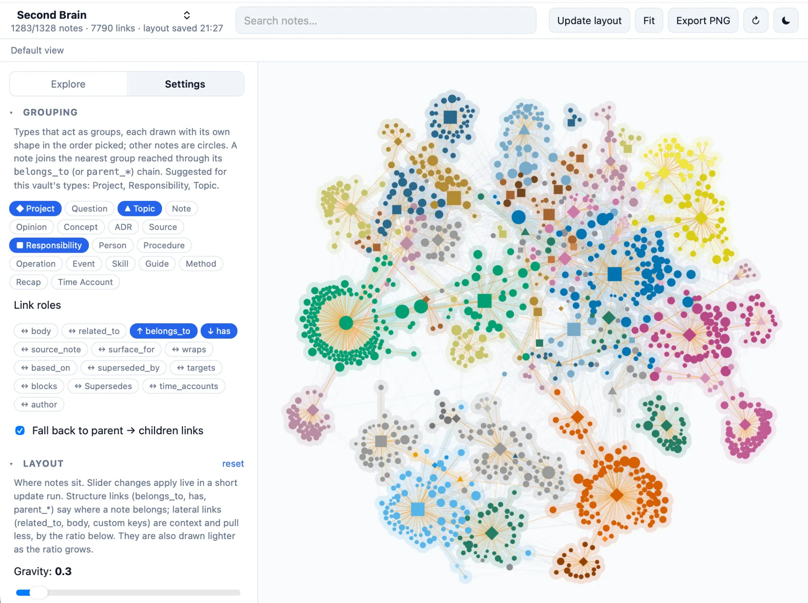

# Brain Graph

An interactive map of a **Second Brain vault**: a folder of Markdown notes with YAML frontmatter and wikilinks, the kind kept with [Tolaria](https://tolaria.md/) and structured with the [Second Brain template](https://github.com/mfoll/second-brain-template). Each note is a node, each relationship a link, and notes are coloured and grouped by the Project, Responsibility or Topic they belong to. The map runs locally from the folder, opens notes back in Tolaria, and never writes to the vault.



[Why a map](#why-a-map) · [What it shows](#what-it-shows) · [Install and run](#install-and-run) · [Everyday use](#everyday-use) · [Vault conventions](#vault-conventions) · [Development](#development) · [How it works](#how-it-works) · [Related tools](#related-tools) · [Status](#status) · [Licence](#licence)

## Why a map

A Second Brain of this kind is a graph by construction. [Portent](https://github.com/refactoringhq/portent), the open specification Tolaria follows, gives notes a `type` (Project, Source, Question, Concept, Person…) and typed relationships: `belongs_to` names a parent, `has` selects entry points, `related_to` links laterally. The [Second Brain template](https://github.com/mfoll/second-brain-template) adds the operating rules for agents and a hierarchy contract: every durable note rolls up to a Responsibility, and Topics stay lateral. Tolaria shows this structure one note at a time, as lists of relationships; it has no graph view ([refactoringhq/tolaria#587](https://github.com/refactoringhq/tolaria/issues/587)), and a plugin system is a tracked feature request rather than something to build on ([#1046](https://github.com/refactoringhq/tolaria/issues/1046)).

Brain Graph is the missing picture. Seen whole, the vault answers questions a list cannot: which projects have grown large, which notes sit far from any Responsibility, where two areas of work actually touch, whether a Topic has quietly become a parent. The same view is an audit instrument for the hierarchy contract: the viewer shows which chain of links it followed for every note and lists those that reach no group, and a companion command prints the inferred hierarchy for an agent to review.

It is a standalone companion, not a Tolaria extension: it reads the vault folder directly, Tolaria is optional, and any folder of Markdown notes whose frontmatter carries a `type` and wikilink relationships works. The conventions it assumes are the Tolaria and template defaults, and every one of them can be changed per vault in Settings.

## What it shows

**Nodes.** One node per note, sized by its number of links. Group types (default Project, Responsibility, Topic) are drawn as shapes in the order picked (◆ ■ ▲ ▬); every other note is a circle. Hovering shows type, status, link counts and the first paragraph, and lights the neighbours. Clicking opens the note.

**Colour by group.** Every note rolls up through its `belongs_to` chain (or `parent_*` keys) to the nearest group note and takes its colour. A slider chooses the roll-up level: colour by first-level Responsibility or Topic, or by individual Project. Six palettes. A vault with no group notes at all falls back to the colours declared on its `Type` notes.

**Links.** One edge per relationship: every frontmatter key whose value contains wikilinks counts, which is Tolaria's rule, so `belongs_to`, `has`, `related_to`, `surface_for` and custom keys such as `source_note` all appear, each toggleable. Body wikilinks are a separate, thinner `body` kind, hidden by default. Structure links (child → parent, parent → children) are drawn stronger than lateral ones, and a single ratio decides how much harder they pull in the layout and how much lighter lateral links are drawn.

**Regions and names.** A tinted region behind each group at the current roll-up level, built from discs around member notes and strokes along the hierarchy links inside the group, so a cluster reads as one shape. Regions scale with zoom and have a size slider. Group names sit at the median of their notes, placed largest first and nudged apart. Regions and names are separate toggles and fade while something is hovered or focused.

**Sidebar.** *Explore* lists Groups (the hierarchy with note counts), Types (expandable to their notes, with facets such as `status` for one-click focus on, say, open Questions) and Links. Clicking a row focuses it: its notes stay lit and labelled, everything else fades, and a group's note opens in the panel. *Settings* holds everything that changes how the map is computed or drawn, split by effect: Grouping, Layout, Appearance, Filters. A state line under the header lists what is in effect (focus, hidden types or links, skeleton view…) and clears it in one click.

**Note panel.** The note's Markdown rendered with callouts, tables and vault images; wikilinks navigate the map. A Links tab groups relationships by kind, a Members tab lists a group's notes by type, and a **why?** link on the breadcrumb shows the exact chain the viewer followed to assign the note. Back and forward arrows replay your path. **Open in Tolaria** uses the `tolaria://<vault>/<path>.md` deep link.

**Audit views.** The Groups tree ends with **Unassigned**, the notes whose chain reaches no group. Filters hide archived notes and orphans, keep only notes with at least N visible links (skeleton view; group notes always stay), collapse one leaf type such as Sources into a `+N` count on its parent, and fade notes by time since last edit.

**Layout.** ForceAtlas2, stepped a few iterations per animation frame and cooled so nodes come to rest within the run. Positions are saved per vault when a run stops, so the map is stable between sessions; new notes settle next to their links while the rest stays put. **Update layout** nudges the current map for under a second; **Reset layout** redoes it from scratch in a few seconds and keeps a backup of the previous map. Nodes are not draggable: hand placement would not survive the next run.

**Sharing.** **Export PNG** saves the current view at twice the screen resolution. The URL carries the vault, note, focus and roll-up level (`?vault=…&note=…&focus=hub:genesis&level=0`), so a note in Tolaria or an agent report can link straight into a view. Everything else you toggle is remembered per vault in the browser.

**Live.** The server watches the vault and the map rebuilds when a note changes.

## Install and run

Brain Graph is a small local web app: a Node process reads your vault and serves the viewer to your browser. It needs [Node.js](https://nodejs.org/) 20.19 or newer and nothing else.

```bash
npx github:mfoll/brain-graph ~/path/to/vault
```

The first run builds the app (about a minute); later runs start in a second. The folder is optional: without one, Brain Graph serves the vaults registered in Tolaria plus the folders you add in the app. Options: `--port 5178`, `--no-open`.

To keep it around, install it once and run it by name:

```bash
npm install -g github:mfoll/brain-graph
brain-graph ~/path/to/vault
```

Then open <http://localhost:5178>. The viewer does not write to the vault. Its own files live in `~/.config/brain-graph/`: `vaults.json` (the vault list) and `layouts/` (one saved map per vault, with a backup).

## Everyday use

- **Switch vaults** with the dropdown at the top left. **Manage vaults…** adds a folder by path, removes one, and chooses whether to include the vaults registered in Tolaria (read from its registry when present). Each vault keeps its own map, filters and grouping; only the selected vault is read.
- **Find a note** with the search box (Enter jumps to it), or follow a link from Tolaria or a report with the URL form above.
- **Read a cluster** by clicking its group in Explore, or a Type facet such as Project → Active. Escape unfocuses, then closes the panel.
- **Review the hierarchy** by focusing Unassigned, opening a suspect note and reading its **why?** chain, then fixing `belongs_to` in Tolaria or with your agent. The map rebuilds on save.
- **Tune the picture** in Settings: pick which types act as groups, raise the structure-over-lateral ratio to tighten clusters, lower link opacity on dense vaults, or hide a noisy relationship kind in Explore → Links. Slider changes run a short layout update so the effect is visible at once.

## Vault conventions

The defaults follow Tolaria and the Second Brain template; each is a per-vault setting.

| Convention | Default | Where to change it |
| --- | --- | --- |
| Group types, in shape order | Project, Responsibility, Topic (Paper, Grant for an archive whose links point to them) | Settings → Grouping |
| Child → parent links | `belongs_to`, `parent_*` keys | Settings → Grouping → Link roles (↑) |
| Parent → children links, followed only as a fallback | `has` | Link roles (↓) and the fallback checkbox |
| Lateral links | `related_to`, `surface_for`, body wikilinks, every other key | Link roles (↔) |
| Type colours when no groups exist | `_color` on `type: Type` notes | the vault's Type notes |
| Archived notes | `_archived: true` or `archived: true` | Settings → Filters |
| Deep links | `tolaria://<slug>/<path>.md`, slug from the vault label | `VAULT_SLUG` |

The `has` fallback exists because vaults use `has` for selective entry points rather than ownership: in the vault pictured above, 299 notes would have been homed through `has` alone before `belongs_to` was given priority. The grouping rules are those of the template's [hierarchy audit](https://github.com/mfoll/second-brain-template); the `graph:homes` command below prints what the viewer infers so the two can be compared.

## Development

```bash
git clone https://github.com/mfoll/brain-graph && cd brain-graph
pnpm install
VAULT=~/path/to/vault VAULT_LABEL="Name" pnpm dev   # Vite dev server with hot reload on :5178
```

`pnpm build` produces `dist/` (the app plus the compiled server), which `bin/brain-graph.mjs` serves; `pnpm start -- ~/path/to/vault` runs that CLI from the checkout. Set `VAULT_SLUG` if the Tolaria deep-link slug differs from the slugified label.

```bash
pnpm typecheck
pnpm graph:dump ~/my-vault -- --summary   # parser statistics and unresolved links
pnpm graph:homes ~/my-vault               # the inferred group hierarchy plus audit lists
                                          # (--no-has, --hubs=Project,Topic, --json)
```

`graph:homes` prints the hierarchy the viewer infers and four audit lists: Projects whose parent is a Topic, notes with several parents at the same distance, notes homed only through a `has` link, and notes with no group at all. It is meant as input for reorganising `belongs_to`; the viewer itself never writes.

Issues and pull requests are welcome. Keep vault assumptions configurable rather than hard-coded, and run `pnpm typecheck` before opening a pull request.

## How it works

- `server/vault.ts` walks the vault (skipping dot-folders), parses frontmatter with `yaml`, extracts the H1, first paragraph, Type metadata and all wikilinks, and resolves link targets (root stems, folder-path stems, `|alias` and `#anchor` forms).
- `server/api.ts` is a framework-free HTTP API: vault registry, parsed graph, note text and assets, saved layouts, and change events over Server-Sent Events (`chokidar` watches the folder). The Vite plugin mounts it in development; `bin/brain-graph.mjs` serves it next to the built app.
- `src/` is React 19 + TypeScript on Vite 8. Rendering uses [Sigma.js](https://www.sigmajs.org/) 4 with [Graphology](https://graphology.github.io/): the declarative styles API maps attributes to colour and size, and node and edge *state* (`isHidden`, `isHighlighted`, `isSelected`) drives filtering and hover emphasis without mutating the graph. Regions are a 2D canvas layer behind the WebGL stage; names are drawn on a layer in front.
- `src/graph/home.ts` assigns each note to its group: strongest child → parent links first, parent → children links as a fallback, with the path recorded so the panel can explain it.
- Layout is graphology's ForceAtlas2 run synchronously a few iterations per frame with a cooling schedule, then normalised once to a fixed extent so saved maps are comparable and **Fit** is a smooth camera move. A worker-based layout was tried and dropped: its adaptive speed cancelled the damping.

## Related tools

| Tool | What it is | Relation |
| --- | --- | --- |
| [Tolaria](https://tolaria.md/) ([source](https://github.com/refactoringhq/tolaria)) | Local-first desktop app for Markdown vaults with typed notes and relationships, Git sync and an MCP server for agents. | The viewer Brain Graph is built for: same files, same conventions, deep links back into it. Tolaria has no graph view and no plugin system yet. |
| [Portent](https://github.com/refactoringhq/portent) | Refactoring's open specification for portable knowledge bases: core types, relationships and lifecycle. | Supplies the vocabulary Brain Graph reads: `type`, `belongs_to`, `has`, `related_to`. |
| [Second Brain template](https://github.com/mfoll/second-brain-template) | A Portent vault template with agent operating rules, Procedures, ADRs and lint audits, including a `belongs_to` hierarchy contract. | Brain Graph is its visual companion: the grouping rules match the template's hierarchy contract, and the audit views and `graph:homes` feed its lint and health review. |
| [Obsidian graph view](https://help.obsidian.md/plugins/graph) | The built-in graph of an Obsidian vault, based on body links. | Zero-setup fallback for any Markdown folder, without frontmatter relationships, types or hierarchy. |
| [Quartz](https://quartz.jzhao.xyz/), [Foam](https://foambubble.github.io/) | A static-site generator and a VS Code extension, each with a link graph. | Need their own build or editor and read body links only. |

## Status

Working and in daily use since October 2026 on a 1,300-note vault. Vaults are shown one at a time; a bridge view of cross-vault pointers is on the backlog. The Tolaria deep-link slug is inferred from the vault label rather than read from Tolaria's registry.

## Licence

MIT, see [LICENSE](LICENSE). Brain Graph is an independent project and is not affiliated with Tolaria or Refactoring.
