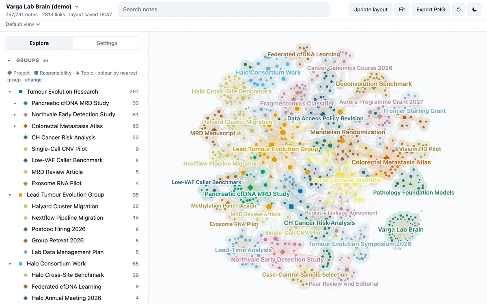
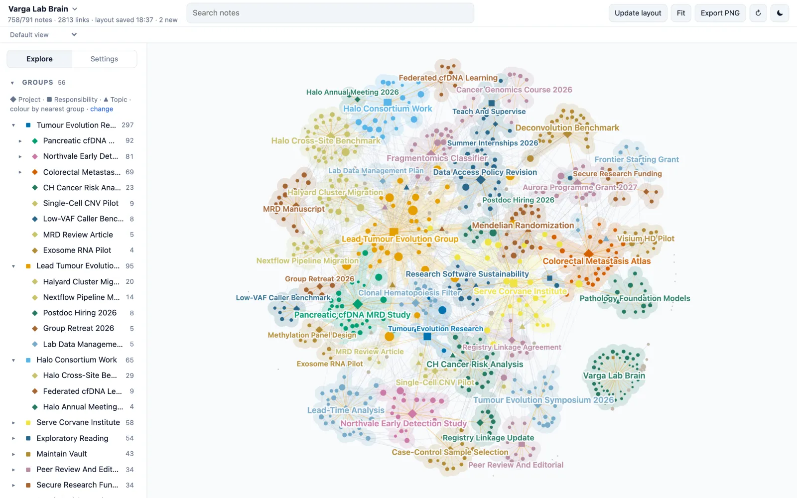
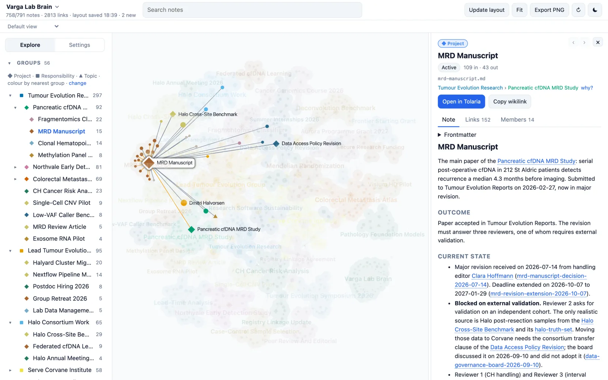
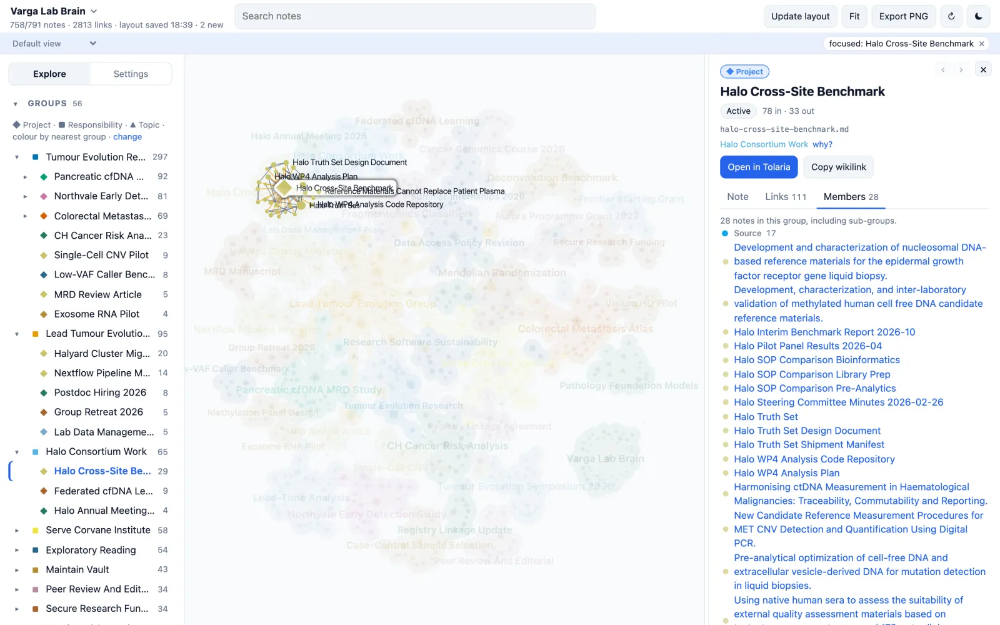
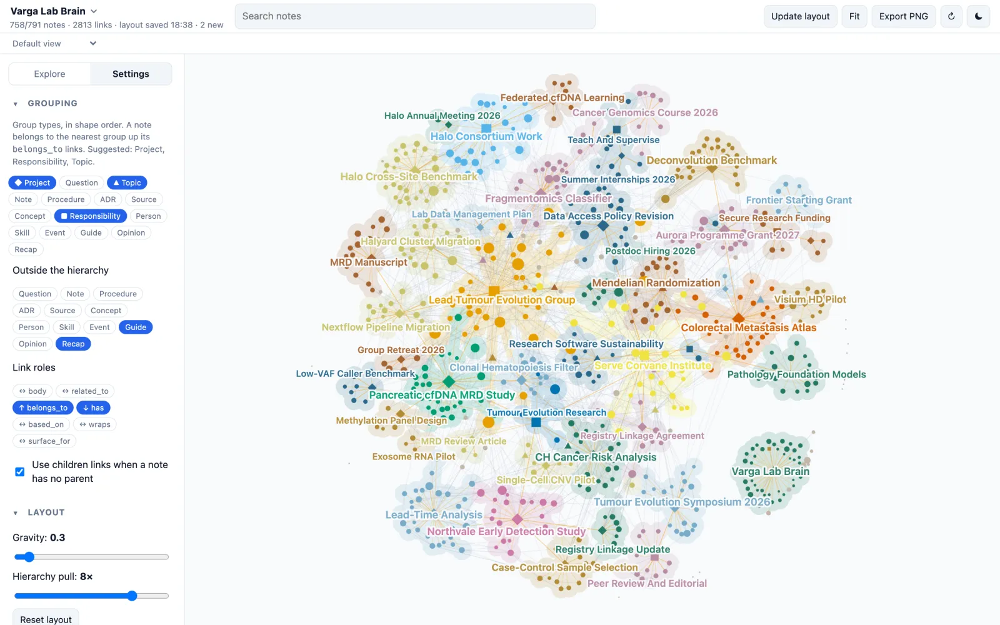
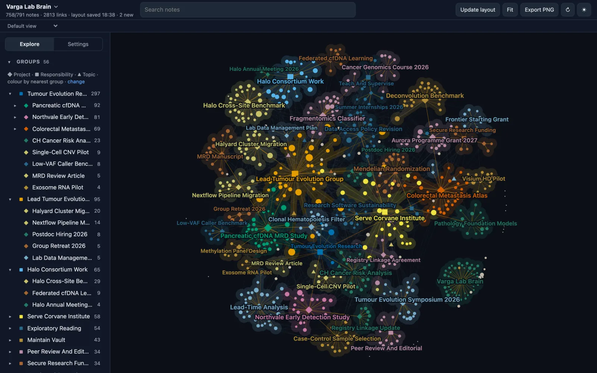

# Brain Graph

An interactive map of a Markdown vault whose notes have a `type` and link to each other through frontmatter, as in [Tolaria](https://tolaria.md/) and the [Second Brain template](https://github.com/mfoll/second-brain-template). Each note is a node and each relationship a link. Notes are coloured and grouped by the Project, Responsibility or Topic they belong to. It runs locally, opens notes in Tolaria, and never writes to the vault.



*Two agents working at once, Claude running a weekly review of six projects and Codex checking whether storage time confounds the Northvale methylation signal: the notes they read glow blue, a dot runs along each link they follow, and the notes they write glow red.*

**[Try the live demo](https://mfoll.github.io/brain-graph-demo/)**: nine fictional vaults in your browser, nothing to install. Pick one from the menu at the top left.

## Screenshots

All screenshots come from the same fictional demo vault of a cancer genomics lab, [Varga Lab Brain](https://github.com/mfoll/second-brain-demo-cancer-lab/blob/main/README.md). Eight more [example vaults](https://github.com/mfoll/second-brain-template#example-vaults) are ready to try: clone one and pass its folder to Brain Graph.



*The whole vault. Each region is a project, responsibility or topic, and every note takes the colour of its nearest group.*

<table>
  <tr>
    <td width="50%"></td>
    <td width="50%"></td>
  </tr>
  <tr>
    <td><b>Read a note.</b> The panel shows the note text. Its links light up on the map, and wikilinks in the text jump to other notes.</td>
    <td><b>Focus a group.</b> Click a project in the tree to fade everything else. The Members tab lists every note it holds.</td>
  </tr>
  <tr>
    <td></td>
    <td></td>
  </tr>
  <tr>
    <td><b>Settings.</b> Choose which types form groups, which link kinds to show, and how strongly parents pull. Settings are kept per vault.</td>
    <td><b>Dark theme.</b> It follows the system setting, or the moon button.</td>
  </tr>
</table>

## Why

[Portent](https://github.com/refactoringhq/portent), the specification Tolaria follows, gives each note a `type` and typed relationships: `belongs_to` points to a parent, `has` lists highlights, `related_to` links sideways. Tolaria shows these relationships one note at a time. It has no graph view ([refactoringhq/tolaria#587](https://github.com/refactoringhq/tolaria/issues/587)) and no plugin system yet ([#1046](https://github.com/refactoringhq/tolaria/issues/1046)).

Brain Graph shows the whole vault at once: how large each project is, where areas of work connect, and which notes have no place in the hierarchy. It reads the folder directly, so Tolaria is optional. Any folder of Markdown notes with a `type` in their frontmatter works.

## Features

- **Groups.** Every note takes the colour of the group it belongs to through its `belongs_to` links. Choose which types count as groups and how deep the colouring goes: top-level groups, their sub-groups, or each note's nearest group. Groups get a shaded region and a name.
- **Links.** Every frontmatter key holding wikilinks becomes a link kind that you can show or hide. Links written in the note text are a separate kind, hidden by default. Parent links pull harder in the layout than other links.
- **Explore.** Browse the group tree, the types and the link kinds in the sidebar. Click any of them to light its notes and fade the rest. Under a type, click a property value such as `status: Active` to light those notes.
- **Note panel.** Read the note with its callouts, tables and images, follow wikilinks across the map, list its links by kind, and see the members of a group. **why?** shows the links that place a note in its group. **Open in Tolaria** opens the note there.
- **Checks.** **Unassigned** lists notes with no group. **Outside the hierarchy** lists notes that are never placed in one, such as Guides or archived notes. Links to missing notes can be shown as grey dots.
- **Other vaults.** When a note's frontmatter holds a path to a note in another vault you have added, that note appears as a rectangle beside it. Hover it for its title, or click it to read it in the panel.
- **Filters.** Hide archived notes, orphans or weakly linked notes. Fold leaf types such as Sources into a count on their parent. Show only the neighbourhood of the selection.
- **Stable layout.** The map is saved per vault and restored on the next start. **Update layout** tidies the current map; **Reset layout** starts again and keeps the previous map as a backup.
- **Views and sharing.** Save a combination of filters, focus and colouring as a named view. The URL holds the vault, note and focus, so another note or a report can link to a view. **Export PNG** saves the current picture.
- **Agent activity.** Notes pulse as Claude Code or Codex read them (blue) and as any app writes them (red), then fade over half a minute, so a session leaves a visible trail. When an agent goes from one note to a linked one, a dot runs along the link. Searches do not light up the vault. See [Agent activity](#agent-activity).
- **Live.** The map updates in place when a note changes on disk. A new note glides out of the note it is most linked to and settles among its siblings, a note given another parent glides to its new group, and a deleted note disappears. Nothing else moves.

## Install

You need [Node.js](https://nodejs.org/) 20.19 or newer.

```bash
npx github:mfoll/brain-graph ~/path/to/vault
```

The first run builds the app, which takes about a minute. Then open <http://localhost:5178>. Without a folder argument, Brain Graph lists the vaults you have opened in Tolaria plus any folder you add in the app. Options: `--port 5178`, `--no-open`. To pin a [release](https://github.com/mfoll/brain-graph/releases), add its tag: `npx github:mfoll/brain-graph#v1.1.0 ~/path/to/vault`.

To install it as a command:

```bash
npm install -g github:mfoll/brain-graph
brain-graph ~/path/to/vault
```

To use it as an app with its own window and Dock icon, open it in Safari and choose **File → Add to Dock**, or in Chrome click the install icon in the address bar. When the server is not running, the app shows the command to start it and reloads by itself once it answers.

### Start at login (macOS)

A server started from a terminal stops when the Mac restarts. To start Brain Graph at every login, and again if it crashes, install a LaunchAgent. Set your vault path on the first line, then paste the whole block:

```bash
VAULT="$HOME/path/to/vault"
cat > ~/Library/LaunchAgents/local.brain-graph.plist <<EOF
<?xml version="1.0" encoding="UTF-8"?>
<!DOCTYPE plist PUBLIC "-//Apple//DTD PLIST 1.0//EN" "https://www.apple.com/DTDs/PropertyList-1.0.dtd">
<plist version="1.0">
<dict>
  <key>Label</key><string>local.brain-graph</string>
  <key>ProgramArguments</key>
  <array>
    <string>$(command -v npx)</string><string>-y</string><string>github:mfoll/brain-graph</string>
    <string>$VAULT</string><string>--no-open</string>
  </array>
  <key>EnvironmentVariables</key>
  <dict><key>PATH</key><string>$(dirname "$(command -v node)"):/usr/bin:/bin</string></dict>
  <key>WorkingDirectory</key><string>$HOME</string>
  <key>RunAtLoad</key><true/>
  <key>KeepAlive</key><dict><key>SuccessfulExit</key><false/></dict>
  <key>ThrottleInterval</key><integer>30</integer>
  <key>StandardOutPath</key><string>$HOME/Library/Logs/brain-graph.log</string>
  <key>StandardErrorPath</key><string>$HOME/Library/Logs/brain-graph.log</string>
</dict>
</plist>
EOF
launchctl bootstrap gui/$(id -u) ~/Library/LaunchAgents/local.brain-graph.plist
```

Each start fetches the latest version from GitHub, so restarting the service also updates Brain Graph. A start that fails, for example without network at login, is tried again every 30 seconds. The log is in `~/Library/Logs/brain-graph.log`.

```bash
launchctl kickstart -k gui/$(id -u)/local.brain-graph   # restart, on the latest version
launchctl bootout gui/$(id -u)/local.brain-graph        # stop until the next login
rm ~/Library/LaunchAgents/local.brain-graph.plist       # after bootout: remove it for good
```

### Start at login (Linux)

On Linux, a systemd user service does the same. Set your vault path on the first line, then paste the whole block:

```bash
VAULT="$HOME/path/to/vault"
mkdir -p ~/.config/systemd/user
cat > ~/.config/systemd/user/brain-graph.service <<EOF
[Unit]
Description=Brain Graph

[Service]
ExecStart=$(command -v npx) -y github:mfoll/brain-graph "$VAULT" --no-open
Environment=PATH=$(dirname "$(command -v node)"):/usr/local/bin:/usr/bin:/bin
WorkingDirectory=%h
Restart=on-failure
RestartSec=30

[Install]
WantedBy=default.target
EOF
systemctl --user daemon-reload
systemctl --user enable --now brain-graph
```

As on macOS, each start fetches the latest version, and a start that fails is tried again after 30 seconds. The log goes to the journal: `journalctl --user -u brain-graph`. A user service starts when you log in; to run it without a login session, for example on a home server, also run `loginctl enable-linger`.

```bash
systemctl --user restart brain-graph                     # restart, on the latest version
systemctl --user stop brain-graph                        # stop until the next login
systemctl --user disable --now brain-graph && rm ~/.config/systemd/user/brain-graph.service   # remove it for good
```

Brain Graph keeps its own files in `~/.config/brain-graph/`: the vault list, and for each vault its saved layout and settings. Copy that folder to keep the same maps and settings on another machine. A coding agent can install and run it from the instructions in [AGENTS.md](AGENTS.md).

## Agent activity

Notes pulse on the map as agents use them: blue when Claude Code or Codex reads a note, red when any app writes one. The glow fades over half a minute, so a session leaves a trail. When an agent reads a note linked to one it read shortly before, a dot runs along that link and the link glows for a few seconds, so you can follow its path through the vault. Turn it off in Settings → Filters → *Pulse notes as agents read and write them*.

**How it works.**

- **Writes** need nothing: the server already watches the vault, so a note saved by an agent, Tolaria or you pulses red.
- **Reads** come from the agents. After each tool call, Claude Code and Codex run a small hook that works out which notes the call read or wrote. It sends their paths to the Brain Graph server on your machine, which forwards them to the open page.
- **Links followed** are inferred, since agents do not say which link they used. When a session reads a note, the most recent note the same session read in the last two minutes that links to it, in either direction, is taken as where it came from. A Project read before five of its notes therefore sends five trails out of the Project. Trails follow every link kind, including links in the note text that the map hides by default. Two sessions running at once are kept apart by the session ID the agents give their hooks.
- Only note paths and the session ID are sent, only to `127.0.0.1`, and nothing is stored. The hook prints nothing, never blocks the agent, and gives up after half a second when Brain Graph is not running.

**Install.**

```bash
npx github:mfoll/brain-graph install-hooks
```

This copies the hook to `~/.config/brain-graph/activity-hook.mjs`. It adds it to `~/.claude/settings.json` and `~/.codex/hooks.json`, for whichever of the two is installed, keeping a backup of each file and leaving other hooks alone. The hook runs the Node that ran the installer, by its full path, so it also works from desktop apps and with version managers such as nvm; if that Node is removed later, it falls back to `node` on the PATH. Name one agent (`install-hooks claude`) to install only that one, and add `--port` if Brain Graph does not run on 5178. New agent sessions pick the hook up. Codex runs a new hook only after you trust it: start `codex` and use `/hooks`. In the Claude desktop app the hook works as in the terminal; in the Codex desktop app it has not been checked yet.

Remove it with:

```bash
npx github:mfoll/brain-graph uninstall-hooks
```

**What counts as a read.**

- Claude Code's Read, Edit and Write tools, and Codex patches, name their files, so those pulses are exact.
- For shell commands the hook only sees the command text. It counts each note named in it as read, unless the program is a search tool (`rg`, `grep`, `find`, `git`) or the note follows `>`. A command that only mentions a note can therefore pulse it. A command that reads notes without naming them, such as `cat *.md` or a script, shows nothing.
- Searches never light up the vault.
- Reading several linked notes in one command, such as `cat` on a whole folder, can draw trails the agent never followed: each still marks a real link between two notes it read in a row.

**Cost.** About 75 ms per file or shell tool call in Claude Code, mostly starting Node, and nothing noticeable in Codex, where the hook runs in the background.

## Using it

- **Switch vaults** from the menu at the top left. **Manage vaults…** adds or removes folders.
- **Search** with the box in the header. Enter opens a single match, or lights all of them.
- **Focus a group** by clicking it in Explore → Groups. Press Escape to unfocus, and again to close the panel.
- **Check the hierarchy**: focus Unassigned, open a note, and read its **why?** line. Fix its `belongs_to` in Tolaria and the map updates.
- **Adjust the picture** in Settings: Grouping decides what forms a group, Layout how tight the map is, Appearance the colours and labels, Filters what is shown.

## Vault conventions

The defaults follow Tolaria and the Second Brain template.

| Convention | Default | Change it in |
| --- | --- | --- |
| Group types | Project, Responsibility, Topic, or the most linked-to types when a vault has none of these | Settings → Grouping |
| Parent links | `belongs_to`, `parent_*` | Settings → Grouping → Link roles |
| Children links, used only when a note has no parent link | `has` | Settings → Grouping |
| Other links | `related_to`, `surface_for`, links in the text, any other key | Settings → Grouping → Link roles |
| Types never placed in a group | Recap, Guide, Operation, Type, and types flagged `hierarchy_exempt: true` | Settings → Grouping → Outside the hierarchy |
| Notes never placed in a group | archived notes, and Inbox notes (`_organized: false` or `status: Unprocessed`) | frontmatter |
| Topics that may head an area | `hierarchy_root: true` | frontmatter |
| Notes allowed two parents | `accepted_double_parent: true` | frontmatter |
| Root type | Responsibility | code only (`rootTypes`) |
| People with no parent | coloured by their first related group | code only (`lateralHomeTypes`) |
| Archived notes | `_archived: true` or `archived: true` | Settings → Filters |
| Colours when a vault has no groups | `_color` on `type: Type` notes | the Type notes |
| Tolaria links | `tolaria://<slug>/<path>.md`, slug from the vault name | `VAULT_SLUG` |

`has` comes second because vaults often use it to list highlights rather than members. These rules match the template's hierarchy audit, so `pnpm graph:homes` and the template's lint report the same warnings.

## Development

Development needs Node.js 22.18 or newer, because the tests and the `graph:*` and `export:static` scripts run TypeScript files directly with `node`. The installed command above only needs 20.19.

```bash
git clone https://github.com/mfoll/brain-graph && cd brain-graph
pnpm install
VAULT=~/path/to/vault VAULT_LABEL="Name" pnpm dev   # dev server with hot reload on port 5178
```

```bash
pnpm typecheck
pnpm test                                 # parser and grouping on test/fixtures/vault
pnpm build                                # app and server into dist/, served by bin/brain-graph.mjs
pnpm start -- ~/path/to/vault             # run the built CLI from the checkout
pnpm graph:dump ~/my-vault -- --summary   # parser statistics and unresolved links
pnpm graph:homes ~/my-vault               # the group hierarchy and its problems
```

`graph:homes` prints the group tree and lists Projects without a proper parent, notes with two parents, notes reached only through `has`, and notes with no group, followed by a summary line. Add `--json` for machine-readable output.

Issues and pull requests are welcome. Keep vault conventions configurable, and run `pnpm typecheck` and `pnpm test` first; GitHub Actions runs both, plus the build, on every push.

### Static demo build

`pnpm build:static` builds the page into `dist-static/` for static hosting such as GitHub Pages: it uses relative URLs, opens no server connection, registers no service worker, keeps layout and settings changes in the visitor's browser, and hides **Open in Tolaria** and **Manage vaults…**. A **Replay agent** button shows the activity pulses and trails without an agent: a made-up session of two agents, built from the vault's own links, reading the most linked Projects and their notes and then writing them. `pnpm export:static -- --config vaults.json --state state --out dist-static` then writes the vaults listed in `vaults.json` (`[{ "label": "…", "path": "…" }]`, paths relative to the file) into `dist-static/data/`, through the server's own handlers, with each vault's layout and settings taken from `state/layouts/<slug>.json` and `state/settings/<slug>.json`. Absolute paths and files in dot-folders are left out.

### Code layout

- `server/vault.ts` reads the vault: frontmatter, titles, first paragraphs and wikilinks.
- `server/api.ts` serves the graph, note text, saved layouts and change events. The Vite plugin uses it in development and `bin/brain-graph.mjs` in the CLI.
- `src/graph/home.ts` decides each note's group.
- `src/graph/build.ts` builds the graph and its colours; `src/graph/hulls.ts` draws regions and names.
- `hooks/activity-hook.mjs` is the agent hook, `bin/hooks.mjs` installs it, `server/activity.ts` turns reports and file changes into activity events, and `src/graph/activity.ts` draws the pulses.
- `src/components/` holds the React interface. Rendering uses [Sigma.js](https://www.sigmajs.org/) 4 and [Graphology](https://graphology.github.io/), with ForceAtlas2 for the layout.

## Related tools

| Tool | Notes |
| --- | --- |
| [Tolaria](https://tolaria.md/) ([source](https://github.com/refactoringhq/tolaria)) | The desktop app Brain Graph is built for. It reads the same files and opens notes from Brain Graph's links. |
| [Portent](https://github.com/refactoringhq/portent) | The open specification behind the note types and relationships. |
| [Second Brain template](https://github.com/mfoll/second-brain-template) | A vault template with agent instructions and lint checks. Brain Graph follows its hierarchy rules. |
| [Example vaults](https://github.com/mfoll/second-brain-template#example-vaults) | Nine fictional vaults built from the template, from a cancer lab to a household, for trying Brain Graph on realistic data. |
| [Obsidian graph view](https://obsidian.md/help/plugins/graph) | Works on any Markdown folder but uses only links in the text, not frontmatter relationships. |
| [Quartz](https://quartz.jzhao.xyz/), [Foam](https://foambubble.github.io/) | Link graphs that need their own site build or editor. |

## Status

In daily use on a vault of about 1,300 notes. One vault is shown at a time; notes from other vaults appear only where this vault links to them. The Tolaria slug is derived from the vault name.

## Licence

MIT, see [LICENSE](LICENSE). Brain Graph is not affiliated with Tolaria or Refactoring.
